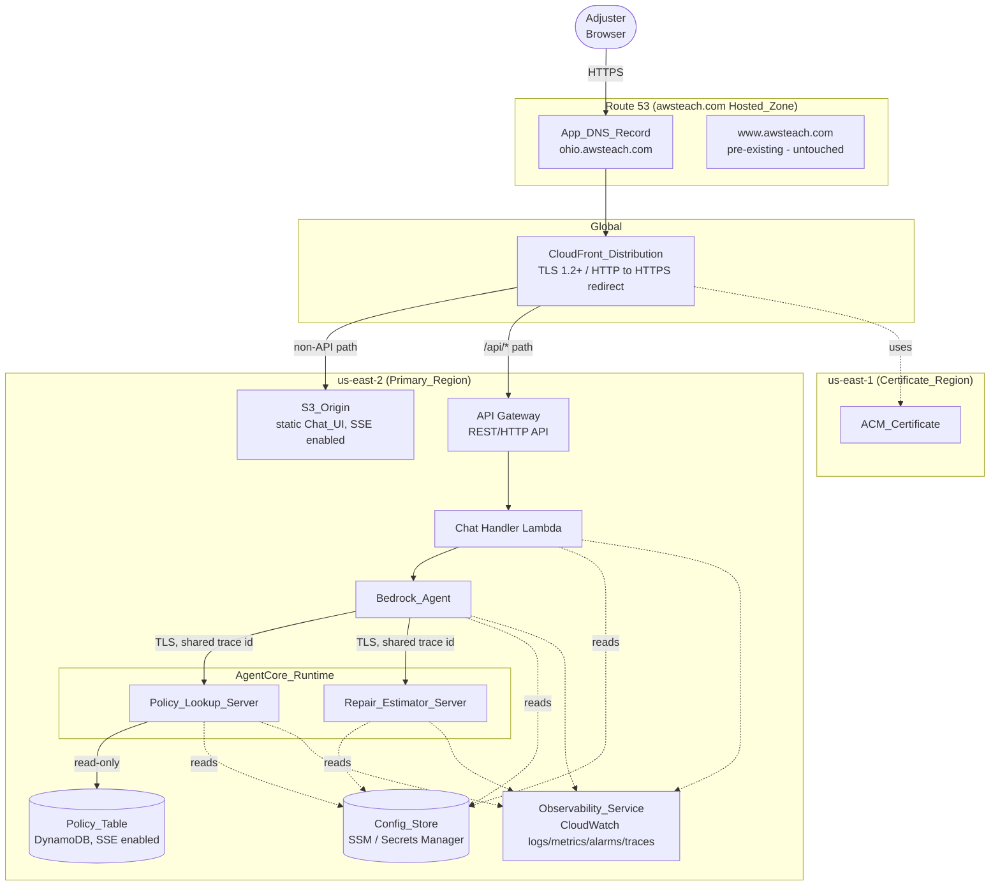

# Design Document

## Overview

ClaimClarify is an auto-insurance claims triage assistant built for a CCC Intelligent Solutions AWS classroom demonstration. A claims adjuster interacts with a static web chat UI that is fronted by Amazon CloudFront. Chat messages travel over HTTPS to an API layer (Amazon API Gateway + AWS Lambda), which validates the request and forwards it to an Amazon Bedrock agent. The agent orchestrates two Model Context Protocol (MCP) servers hosted on Amazon Bedrock AgentCore Runtime: a `policy-lookup` server (coverage, deductibles, prior-claim history from an encrypted DynamoDB `Policy_Table`) and a `repair-estimator` server (severity classification, repair cost, and turnaround estimates derived from a structured `Claim_Input`). The agent composes a natural-language triage answer from the tool results and returns it to the UI.

The entire stack is defined as infrastructure-as-code (AWS CDK or Terraform) and is deployable/tearable repeatably. Application compute and data live in `us-east-2` (Primary_Region). The ACM certificate for CloudFront is created and validated in `us-east-1` (Certificate_Region). DNS is served from the existing Route 53 hosted zone `awsteach.com`, where the deployment publishes a new, unique record (for example `ohio.awsteach.com`) without touching the pre-existing `www.awsteach.com` record.

The design emphasizes enterprise-quality practices: dedicated least-privilege IAM roles per component, encryption at rest and in transit, CloudWatch logs/metrics/alarms with distributed tracing linking agent requests to MCP tool invocations, strict input validation with structured error handling, and separation of configuration and secrets from source code via SSM Parameter Store / Secrets Manager.

### Design Goals

| Goal | Driven By |
|------|-----------|
| Single-response triage combining policy and repair data | Req 1, 3 |
| Secure public access with TLS 1.2+ | Req 7, 11 |
| Deterministic, validated tool behavior | Req 4, 6, 13 |
| Repeatable, non-destructive IaC with teardown | Req 8, 9, 14 |
| Least-privilege and encryption everywhere | Req 10, 11 |
| Full observability and tracing | Req 12 |
| No secrets in code | Req 15 |

### Key Design Decisions and Rationale

- **API Gateway + Lambda proxy to Bedrock** rather than a direct browser-to-Bedrock call. This keeps Bedrock credentials server-side, centralizes input validation and error normalization (Req 2, 13), and provides a natural place for CloudWatch metrics and tracing (Req 12).
- **MCP servers on AgentCore Runtime (mandatory)** rather than plain Lambda tools. The demo's learning objective is AgentCore; the two tool domains map cleanly to two independently deployed MCP servers that the agent orchestrates (Req 3, 4, 6).
- **Two-region split** (`us-east-2` for compute/data, `us-east-1` for ACM). CloudFront requires its ACM certificate in `us-east-1`; everything else stays in Ohio to meet the regional placement requirement (Req 8).
- **New unique DNS record with conflict halt.** Because `awsteach.com` is shared, the deployment must create its own record and abort rather than mutate anything pre-existing (Req 9).
- **Pure, deterministic estimation logic** inside `repair-estimator` so its behavior is testable with property-based tests (Req 6) independent of AWS I/O.

## Architecture

### System Context



### Request Sequence (combined policy + repair query)

```mermaid
sequenceDiagram
    participant U as Adjuster (Chat_UI)
    participant CF as CloudFront
    participant API as API_Layer (APIGW+Lambda)
    participant AG as Bedrock_Agent
    participant PL as Policy_Lookup_Server
    participant RE as Repair_Estimator_Server
    participant DB as Policy_Table

    U->>CF: POST /api/chat (HTTPS, message)
    CF->>API: forward (/api/*)
    API->>API: validate schema (non-empty, <=2000 chars, <=1MB)
    alt validation fails
        API-->>U: 400 + which constraint failed
    else valid
        API->>AG: invoke agent (trace id)
        par policy branch
            AG->>PL: coverage/deductible/prior-claims (TLS, trace id)
            PL->>DB: read policy record
            DB-->>PL: record / not-found
            PL-->>AG: result or structured error
        and repair branch
            AG->>RE: classify + estimate (TLS, trace id)
            RE-->>AG: severity, cost, turnaround or validation error
        end
        AG->>AG: compose NL response (incorporate each result;<br/>name any failed tool)
        AG-->>API: composed response
        alt agent fails or >25s
            API-->>U: 502 agent invocation failed
        else success
            API-->>U: 200 response
        end
        U->>U: render in conversation history
    end
```

The Chat_UI runs its own 30-second client timeout (Req 1.6) independent of the API layer's 25-second agent timeout (Req 2.5); the agent runs a 20-second per-tool timeout (Req 3.5). These nested timeouts guarantee that an inner failure surfaces as a structured error before the next outer layer gives up.

### Component-to-Region Mapping (Req 8)

| Component | Region |
|-----------|--------|
| Bedrock_Agent, MCP servers (AgentCore_Runtime), Policy_Table, API_Layer, S3_Origin, CloudWatch | Primary_Region (`us-east-2`) |
| ACM_Certificate | Certificate_Region (`us-east-1`) |
| CloudFront_Distribution | Global (uses `us-east-1` certificate) |
| Route 53 Hosted_Zone / App_DNS_Record | Global |

## Components and Interfaces

### 1. Chat_UI (static front end)

Single-page application stored in `S3_Origin` and served through CloudFront. Responsibilities:

- Render a text input (1–2,000 chars) and a conversation history (Req 1.1).
- Client-side length validation: reject empty or >2,000-char submissions, show an allowed-range error, and retain the typed text (Req 1.3).
- Submit valid messages over HTTPS to `/api/chat` (Req 1.2).
- Show a pending indicator while awaiting a response (Req 1.5); enforce a 30-second client timeout that removes the indicator and shows a timeout error (Req 1.6).
- Render success responses as new history entries (Req 1.4); on error responses, remove the indicator, show a failure-identifying message, and preserve history (Req 1.7).

The UI reads only the API base path (same origin via CloudFront), so no secrets are embedded.

### 2. API_Layer (API Gateway + Chat Handler Lambda)

**Interface:** `POST /api/chat`

Request:
```json
{ "message": "string (1..2000 chars)", "sessionId": "string (optional)" }
```

Success (HTTP 200):
```json
{ "response": "string", "sessionId": "string", "traceId": "string" }
```

Error (HTTP 400 / 502):
```json
{ "error": { "code": "VALIDATION_ERROR | AGENT_ERROR", "message": "string", "field": "string (optional)" }, "traceId": "string" }
```

Responsibilities:
- Enforce TLS 1.2+ at API Gateway; reject non-TLS connections (Req 11.3, 11.4).
- Validate request body against schema before invoking the agent: valid JSON shape, non-empty `message`, `message` length ≤ 2,000, total payload ≤ 1 MB (Req 2.3, 13.1).
- On validation failure, return 400 identifying the violated constraint, without invoking the agent (Req 2.4, 13.4).
- Invoke the Bedrock_Agent and return its result as 200 (Req 2.1, 2.2).
- Apply a 25-second agent-invocation timeout; on agent failure or timeout, return 502 with a structured error identifying the agent failure (Req 2.5, 13.5).
- Generate/propagate a shared `traceId` for every request (Req 12.5).
- Retrieve agent/runtime configuration from `Config_Store` at runtime; fail with a configuration-retrieval error if unavailable, never falling back to embedded values (Req 15.2, 15.3).

### 3. Bedrock_Agent

Orchestrates the two MCP servers via AgentCore Runtime.

Responsibilities:
- Invoke a `policy-lookup` tool when the query needs policy information (Req 3.1).
- Invoke a `repair-estimator` tool when the query needs damage/repair information (Req 3.2).
- Invoke both when the query needs both, before composing a response (Req 3.3).
- Compose a natural-language response incorporating every returned tool result (Req 3.4).
- Enforce a 20-second per-tool timeout; on tool error or timeout, compose a response that names the failed tool (Req 3.5).
- On partial failure (one tool succeeds, one fails), incorporate the success and identify the failed tool (Req 3.6).
- Call MCP servers over transport-encrypted connections, propagating the shared trace id (Req 11.5, 12.5).
- Use a dedicated IAM role (Req 10.1) and read its configuration from `Config_Store` (Req 15.2).

### 4. Policy_Lookup_Server (MCP server on AgentCore_Runtime)

Deployed to AgentCore_Runtime in Primary_Region (Req 4.1). Read-only against `Policy_Table` (Req 10.2).

Tools:

| Tool | Input | Output |
|------|-------|--------|
| `get_coverage` | `{ policyId: string }` | coverage details |
| `get_deductibles` | `{ policyId: string }` | deductible amounts |
| `get_prior_claims` | `{ policyId: string }` | prior claim history |

Behavior:
- Validate input against the tool schema before processing (Req 13.2). `policyId` must be present, non-empty, and ≤ 64 chars; otherwise return a structured validation-error result identifying the invalid input and leave the table unchanged (Req 4.6, 13.4).
- For an existing policy id, return the requested data within 3 seconds (Req 4.2, 4.3, 4.4).
- For a non-existent policy id, return a structured not-found result identifying the missing id, leaving the table unchanged (Req 4.5).
- All table access is read-only; the server never writes or deletes (Req 10.2).
- Retrieve the table name/config from `Config_Store` (Req 15.2); emit logs/metrics/traces (Req 12.1, 12.2, 12.5).

### 5. Repair_Estimator_Server (MCP server on AgentCore_Runtime)

Deployed to AgentCore_Runtime in Primary_Region (Req 6.1). Pure, deterministic estimation logic with no external data store, which makes it ideal for property-based testing.

Tool: `estimate_repair`

Input (`Claim_Input`):
```json
{
  "vehicleYear": "integer (1980..currentYear+1)",
  "impactLocation": "front | rear | side | roof | undercarriage",
  "driveable": "boolean",
  "airbagDeployed": "boolean",
  "visibleDamagePanels": "integer (0..20)"
}
```

Output (success):
```json
{ "severity": "minor | moderate | severe | total_loss", "estimatedCostUsd": "number >= 0", "turnaroundDays": "integer >= 0" }
```

Behavior:
- Validate `Claim_Input` against the input schema before processing (Req 6.5, 13.3). If a required attribute is missing or a value is out of range, return a structured validation-error result identifying the invalid field and return no severity/cost/turnaround (Req 6.5, 13.4).
- For valid input, return a severity from the predefined set, a non-negative cost, and a non-negative turnaround in days, within 3 seconds (Req 6.2, 6.3, 6.4).
- Emit logs/metrics/traces (Req 12.1, 12.2, 12.5).

### 6. CloudFront_Distribution + S3_Origin

- Serve Chat_UI assets from `S3_Origin` (Req 7.1); S3 encryption at rest enabled (Req 7.2, 11.2).
- Serve all content over HTTPS with TLS 1.2 minimum (Req 7.3); redirect HTTP to HTTPS (Req 7.4).
- Route `/api/*` paths to the API_Layer and all other paths to `S3_Origin` (Req 7.5, 7.6) via distinct cache behaviors.
- Access S3 via Origin Access Control granting read-only; no write/delete (Req 10.4).
- Use the ACM_Certificate from `us-east-1` (Req 8.4).

### 7. IaC_Template

- Defines all resources via AWS CDK or Terraform (Req 14.1).
- Provisions all resources on apply (Req 14.2) and is idempotent: re-apply against an already-provisioned environment leaves existing resources unchanged (Req 14.3).
- Creates the ACM_Certificate in `us-east-1` and waits for issued+validated before provisioning CloudFront; halts with a certificate validation failure identifying the certificate if validation does not complete (Req 8.2, 8.3).
- Creates `App_DNS_Record` as a new record pointing to CloudFront, with a name distinct from `www.awsteach.com`; leaves `www.awsteach.com` unchanged; on a name conflict, reports it, halts the entire deployment, and leaves all existing records unchanged (Req 9.1–9.4).
- Seeds `Policy_Table` with ≥ 5 unique policy records; on a duplicate policy id during seeding, reports a duplicate-identifier error and does not overwrite (Req 5.2, 5.4).
- Provisions a dedicated IAM role per component with least privilege (Req 10.1, 10.3).
- Stores configuration and secrets in `Config_Store`, granting each component read access only to the entries it needs (Req 14.6, 15.1, 15.4).
- Supports teardown that removes all created resources and reports any that could not be removed (Req 14.4, 14.5).

## Data Models

### Policy Record (Policy_Table item)

Partition key: `policyId` (unique across the table — Req 5.3).

```json
{
  "policyId": "POL-100001",
  "holderName": "string",
  "coverage": {
    "collision": true,
    "comprehensive": true,
    "liabilityLimitUsd": 100000,
    "rentalReimbursement": false
  },
  "deductibles": {
    "collisionUsd": 500,
    "comprehensiveUsd": 250
  },
  "priorClaims": [
    { "claimId": "CLM-0001", "date": "2023-04-12", "amountUsd": 3200, "atFault": true }
  ]
}
```

DynamoDB table configuration: on-demand billing, encryption at rest enabled (Req 5.5, 11.1), point-in-time recovery optional for the demo.

### Claim_Input (Repair_Estimator_Server)

```json
{
  "vehicleYear": 2019,
  "impactLocation": "front",
  "driveable": false,
  "airbagDeployed": true,
  "visibleDamagePanels": 4
}
```

Validation rules:

| Field | Rule |
|-------|------|
| `vehicleYear` | integer, 1980 ≤ year ≤ currentYear+1 |
| `impactLocation` | one of `front, rear, side, roof, undercarriage` |
| `driveable` | boolean (required) |
| `airbagDeployed` | boolean (required) |
| `visibleDamagePanels` | integer, 0 ≤ n ≤ 20 |

### Severity levels (predefined set — Req 6.2)

`minor`, `moderate`, `severe`, `total_loss`

### Structured Error Result (shared across components — Req 13.4, 13.5)

```json
{
  "error": {
    "type": "VALIDATION_ERROR | NOT_FOUND | DEPENDENCY_ERROR | TIMEOUT | CONFIG_ERROR",
    "field": "string (optional, for validation errors)",
    "dependency": "string (optional, for dependency errors)",
    "message": "human-readable description"
  }
}
```

### Trace Context (Req 12.5)

A single `traceId` (string) is created at the API_Layer and propagated to the agent and onward to each MCP tool invocation, so logs and traces across layers correlate to one adjuster request.

## Correctness Properties

*A property is a characteristic or behavior that should hold true across all valid executions of a system—essentially, a formal statement about what the system should do. Properties serve as the bridge between human-readable specifications and machine-verifiable correctness guarantees.*

PBT (property-based testing) applies to ClaimClarify's pure, deterministic logic: client-side and API-layer input validation, the repair-estimator classification/estimation, the policy-lookup read semantics and validation, response composition, path routing, trace-id propagation, the seed-integrity rules, the IaC idempotence check, and the config-retrieval error path. Infrastructure concerns (region placement, encryption-at-rest config, IAM least-privilege policies, CloudWatch alarms/logs/metrics, ACM validation ordering, agent LLM-driven tool routing, non-TLS rejection) are validated with synthesis/snapshot, smoke, and integration tests instead (see Testing Strategy). The properties below were consolidated from the prework analysis to remove redundancy.

### Property 1: Client-side message length validation

*For any* input string, the Chat_UI submit validator accepts it if and only if its length is between 1 and 2,000 characters inclusive; for any rejected string the UI shows an allowed-range error and retains the entered text unchanged.

**Validates: Requirements 1.3**

### Property 2: API request validation gate

*For any* request body, the API_Layer validator accepts it if and only if it conforms to the request schema, its `message` is non-empty, its `message` length is ≤ 2,000 characters, and its total payload size is ≤ 1 MB; for any body that fails, the API returns HTTP 400 identifying the violated constraint and does not invoke the Bedrock_Agent.

**Validates: Requirements 2.3, 2.4, 13.1**

### Property 3: Agent response composition over mixed tool results

*For any* set of tool invocation outcomes (each either a success result or a failure), the composed Bedrock_Agent response references every successful result and names every tool that failed.

**Validates: Requirements 3.4, 3.5, 3.6**

### Property 4: Policy lookup fidelity

*For any* policy record present in the store and any of the three lookup tools (`get_coverage`, `get_deductibles`, `get_prior_claims`), invoking that tool with the record's `policyId` returns exactly the corresponding data stored for that policy.

**Validates: Requirements 4.2, 4.3, 4.4**

### Property 5: Policy not-found leaves store unchanged

*For any* `policyId` that is absent from the store, each policy-lookup tool returns a structured NOT_FOUND result identifying the missing `policyId`, and the store's contents are identical before and after the call.

**Validates: Requirements 4.5**

### Property 6: Policy identifier validation

*For any* tool input whose `policyId` is absent, empty, or longer than 64 characters, the Policy_Lookup_Server returns a structured VALIDATION_ERROR identifying the invalid input and leaves the store unchanged.

**Validates: Requirements 4.6, 13.2**

### Property 7: Seed integrity

*For any* seed data set the IaC_Template applies, the seeded `Policy_Table` contains at least 5 records, every record contains coverage, deductible, and prior-claim data, and all `policyId` values are pairwise distinct.

**Validates: Requirements 5.2, 5.3**

### Property 8: Duplicate-identifier seeding is rejected

*For any* seed batch that contains a `policyId` already present in the `Policy_Table`, the IaC_Template reports a duplicate-identifier error and the pre-existing record for that `policyId` is left unchanged (not overwritten).

**Validates: Requirements 5.4**

### Property 9: Estimator output is well-formed for valid input

*For any* valid `Claim_Input`, the Repair_Estimator_Server returns a `severity` drawn from the predefined set `{minor, moderate, severe, total_loss}`, an `estimatedCostUsd` ≥ 0, and a `turnaroundDays` ≥ 0.

**Validates: Requirements 6.2, 6.3, 6.4**

### Property 10: Estimator input validation

*For any* `Claim_Input` that is missing a required attribute or contains an attribute value outside its permitted range, the Repair_Estimator_Server returns a structured VALIDATION_ERROR identifying the invalid field and returns no severity, cost, or turnaround.

**Validates: Requirements 6.5, 13.3**

### Property 11: Path routing

*For any* request path, the CloudFront routing classifier selects the API_Layer behavior if and only if the path matches the API prefix (`/api/*`), and otherwise selects the S3_Origin behavior.

**Validates: Requirements 7.5, 7.6**

### Property 12: DNS record name precheck

*For any* configured `App_DNS_Record` name and any snapshot of the Hosted_Zone, the deployment precheck proceeds only if the name differs from `www.awsteach.com` and does not already exist in the zone; otherwise it reports a conflict and signals a halt without changing any record.

**Validates: Requirements 9.2, 9.4**

### Property 13: Shared trace-id propagation

*For any* request trace identifier created at the API_Layer, every MCP tool invocation emitted while handling that request carries the identical trace identifier.

**Validates: Requirements 12.5**

### Property 14: Structured validation-error shape

*For any* invalid input to any validating component (Chat_UI, API_Layer, Policy_Lookup_Server, Repair_Estimator_Server), the returned error result conforms to the structured error schema with its `type` set to `VALIDATION_ERROR` and its `field` populated with the failing field.

**Validates: Requirements 13.4**

### Property 15: Structured dependency-error shape

*For any* downstream dependency failure, the calling component returns a structured error result whose `type` is `DEPENDENCY_ERROR` (or `TIMEOUT`) and whose `dependency` names the failed dependency.

**Validates: Requirements 13.5**

### Property 16: IaC idempotence

*For any* already-provisioned environment, applying the IaC_Template a second time produces an empty change set, leaving all previously provisioned resources unchanged.

**Validates: Requirements 14.3**

### Property 17: Config retrieval has no code fallback

*For any* required configuration key that is missing from the Config_Store, the component's config loader returns a CONFIG_ERROR and never returns a value embedded in source code.

**Validates: Requirements 15.3**

## Error Handling

Errors are normalized to the shared structured error result (`type`, optional `field`, optional `dependency`, `message`) and surfaced at the layer appropriate to the failure. Each layer wraps the one below it with a shorter timeout so inner failures surface as structured errors before the outer layer times out.

| Failure | Where handled | Behavior | Requirements |
|---------|---------------|----------|--------------|
| Empty / >2,000-char message | Chat_UI | Reject submit, show allowed-range error, retain input text | 1.3 |
| No response within 30s | Chat_UI | Remove pending indicator, show timeout error | 1.6 |
| API returns error | Chat_UI | Remove indicator, show failure-identifying message, preserve history | 1.7 |
| Request fails schema/size validation | API_Layer | HTTP 400 naming the violated constraint; agent not invoked | 2.4, 13.1, 13.4 |
| Non-TLS connection attempt | API_Layer / API Gateway | Reject connection | 11.3, 11.4 |
| Agent invocation fails or >25s | API_Layer | HTTP 502 structured agent-failure error | 2.5, 13.5 |
| Tool error or >20s per tool | Bedrock_Agent | Compose response naming the failed tool; include any successful results | 3.5, 3.6 |
| Invalid `policyId` (absent/empty/>64) | Policy_Lookup_Server | VALIDATION_ERROR, table unchanged | 4.6, 13.2, 13.4 |
| Unknown `policyId` | Policy_Lookup_Server | NOT_FOUND naming the id, table unchanged | 4.5 |
| Invalid `Claim_Input` | Repair_Estimator_Server | VALIDATION_ERROR naming the field, no estimate | 6.5, 13.3, 13.4 |
| ACM certificate not validated | IaC_Template | Halt deployment, report certificate validation failure | 8.3 |
| DNS name conflict | IaC_Template | Report conflict, halt entire deployment, leave all records unchanged | 9.4 |
| Duplicate policy id at seed | IaC_Template | Report duplicate-identifier error, do not overwrite | 5.4 |
| Teardown cannot remove a resource | IaC_Template | Report which resources were not removed | 14.5 |
| Config/secret retrieval fails | Any component | Report CONFIG_ERROR, no embedded fallback | 15.3 |

**Propagation principle (Req 13.5):** when a component calls a downstream dependency that returns an error, the caller does not leak the raw downstream error; it returns a structured `DEPENDENCY_ERROR` identifying the dependency, preserving the shared `traceId` for correlation.

## Testing Strategy

A dual approach: property-based tests verify the universal properties above across many generated inputs, while unit, snapshot, smoke, and integration tests cover specific examples, infrastructure configuration, and external-service wiring.

### Property-Based Tests

- Use an established PBT library for the implementation language (for example, `fast-check` for TypeScript or `Hypothesis` for Python). Do not hand-roll property testing.
- Each property-based test runs a minimum of 100 generated iterations.
- Each test is tagged with a comment referencing its design property using the form `Feature: claimclarify, Property <N>: <property text>` (substituting the property number and text).
- One property-based test per correctness property (Properties 1–17).
- Generators of note:
  - `Claim_Input` generator producing both valid inputs and inputs with missing/out-of-range fields (drives Properties 9, 10) — include non-ASCII and boundary values.
  - Policy-store generator producing records with unique and (for Property 8) deliberately duplicated ids.
  - Request-body generator spanning valid shapes, empty/overlong messages, and oversized payloads (Properties 1, 2).
  - Mixed tool-result generator for composition (Property 3).
  - Path generator spanning API-prefixed and non-prefixed paths (Property 11).
- Pure logic (estimator, validators, composer, router, config loader, trace propagation) is tested in isolation without AWS I/O; where a store is needed, an in-memory fake is used so iterations stay fast and cheap.

### Unit and Example Tests

- Chat_UI rendering and interaction: input + history present (1.1), valid submit fires request (1.2), response renders as a new entry (1.4), pending indicator shown (1.5), 30s timeout path with fake timers (1.6), error path preserves history (1.7).
- API_Layer mapping: success → 200 (2.2), agent error/timeout → 502 (2.5).
- Config loader reads from Config_Store at runtime (15.2).

### Integration Tests (1–3 representative examples each)

- Agent orchestration/routing: policy-only, repair-only, and combined queries invoke the expected tool(s) before composing (3.1, 3.2, 3.3) — mocked or sandboxed agent.
- API forwards valid request to the agent (2.1).
- Agent-to-MCP calls use transport-encrypted connections (11.5).
- ACM certificate created in `us-east-1`, issued/validated before CloudFront, with a simulated-failure case for the halt path (8.2, 8.3).
- `www.awsteach.com` unchanged across apply (9.3).
- IaC apply provisions all resources; teardown removes them and reports failures (14.2, 14.4, 14.5).

### Infrastructure Snapshot / Synthesis Tests

Run against the synthesized template (`cdk synth` assertions or Terraform `plan`/policy checks):

- Region placement of all core resources in `us-east-2`; CloudWatch in `us-east-2`; CloudFront uses the `us-east-1` certificate (8.1, 8.4, 8.5).
- Encryption at rest on `Policy_Table` and `S3_Origin` (5.5, 7.2, 11.1, 11.2).
- CloudFront viewer protocol HTTPS, min TLS 1.2, HTTP→HTTPS redirect, S3 and API behaviors (7.1, 7.3, 7.4), API Gateway min TLS policy (11.3).
- Dedicated, non-shared IAM role per component; policy-lookup read-only on the table; CloudFront OAC read-only on S3; no extra/wildcard permissions (10.1, 10.2, 10.3, 10.4).
- Log groups for all four components; invocation/error/latency metrics for API Lambda and MCP servers; alarm threshold 5% over a 5-minute window with ALARM/OK transitions (12.1, 12.2, 12.3, 12.4).
- `App_DNS_Record` targets CloudFront with a name distinct from `www.awsteach.com` (9.1, 9.2).
- Config/secrets sourced from Config_Store with per-component least-privilege read scoping; no embedded secrets in source (14.1, 14.6, 15.1, 15.4).

### Smoke Tests (single execution)

- MCP servers deployed to AgentCore_Runtime in `us-east-2` and reachable (4.1, 6.1).
- Non-TLS request to the API endpoint is rejected (11.4).
- Deployed stack serves the Chat_UI over HTTPS at the `App_DNS_Record` URL.
